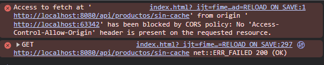
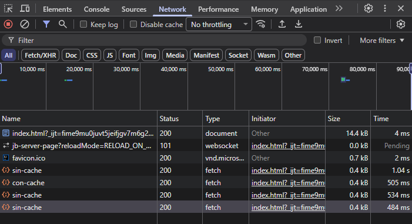
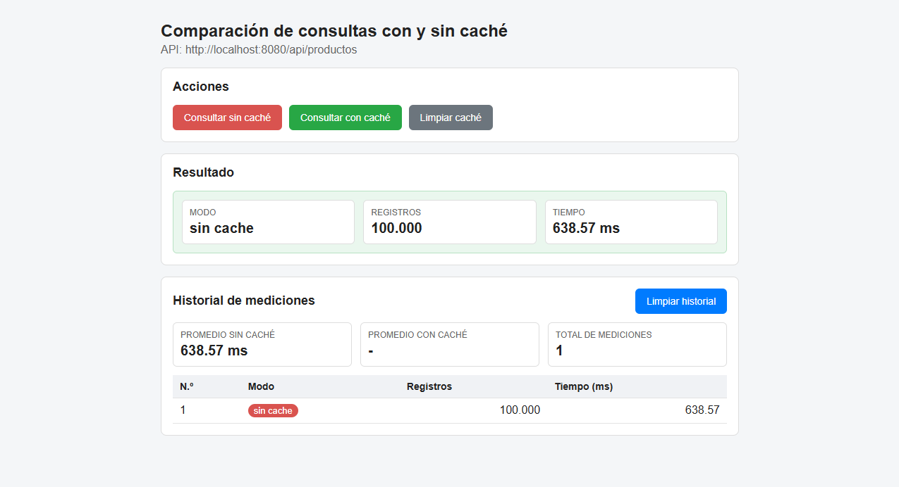
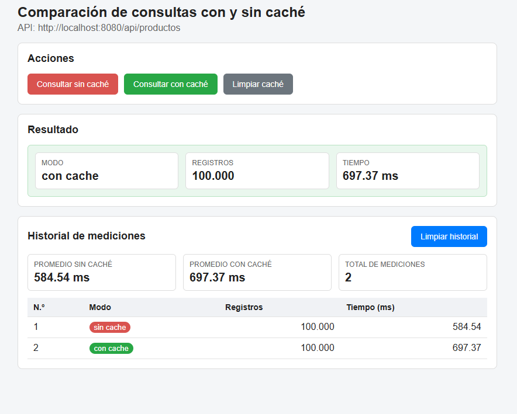
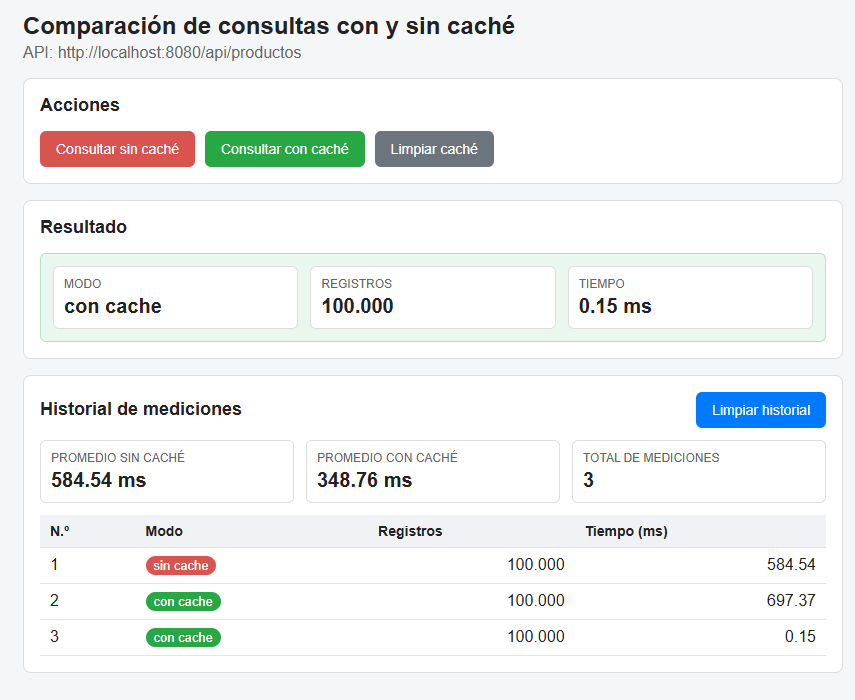
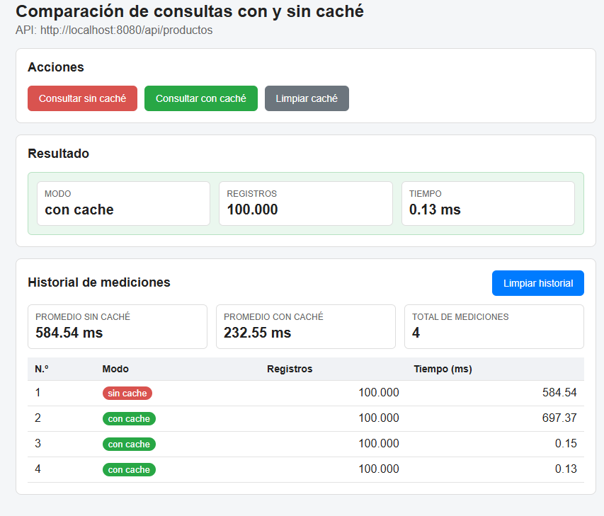

# Comparación de tiempos de acceso con y sin caché (Java + Spring Boot)

Aplicación en **Java con Spring Boot** que lee **100 000 registros** de una base de datos SQL Server, compara el tiempo de acceso **sin caché** y **con caché** (`@Cacheable`) y muestra los resultados en un front web generado con IA. También documenta el problema de **CORS** y cómo se resolvió en desarrollo.

---

## ⚡ Inicio rápido

1. SQL Server debe tener **TCP/IP habilitado en el puerto 1433** y **autenticación de SQL Server (modo mixto)** activada. Si no lo tiene, ver la sección [3.2](#32-configurar-sql-server).
2. Abrir `database/crear_base_cachedemo.sql` en SSMS y ejecutarlo completo (F5). Crea la base, la tabla, los 100 000 registros y el usuario que usa la aplicación.
3. Abrir el proyecto en IntelliJ y ejecutar `DemoApplication` (▶).
4. Abrir en el navegador **http://localhost:8080**

No hace falta editar ningún archivo de configuración.

---

## 1. Tecnologías

| Parte | Tecnología |
|---|---|
| Lenguaje | Java 17 o superior |
| Framework | Spring Boot 4.1.1 (Spring Web MVC, Spring Data JPA, Spring Cache) |
| Base de datos | SQL Server (base `CacheDemo`, tabla `producto`) |
| Driver | Microsoft JDBC Driver for SQL Server (`mssql-jdbc`) |
| Front | HTML + CSS + JavaScript puro (`fetch`), generado con IA |
| IDE | IntelliJ IDEA |

## 2. Estructura del proyecto

```
demo/
├── pom.xml
├── README.md
├── database/crear_base_cachedemo.sql   ← script de la base de datos
├── docs/capturas/                      ← evidencias
└── src/main/
    ├── java/com/example/demo/
    │   ├── DemoApplication.java        ← @EnableCaching (activa la caché)
    │   ├── model/Producto.java         ← Entity: representa una fila de la tabla
    │   ├── repository/ProductoRepository.java  ← JpaRepository (findAll, etc.)
    │   ├── service/ProductoService.java        ← @Cacheable / @CacheEvict
    │   └── controller/ProductoController.java  ← endpoints REST + medición de tiempo + @CrossOrigin
    └── resources/
        ├── application.properties      ← conexión a SQL Server
        └── static/index.html           ← front generado con IA
```

Flujo de una petición:

```
Navegador ──► Controller ──► Service ──► Repository ──► SQL Server
             (mide tiempo)   (caché)     (consulta)
```

---

## 3. Cómo ejecutar el proyecto

### 3.1 Requisitos

- JDK 17 o superior
- SQL Server con SSMS
- IntelliJ IDEA (Maven viene incluido en el proyecto con `mvnw`)
- Un navegador (Chrome o Edge)

### 3.2 Configurar SQL Server

Java solo se conecta a SQL Server por **TCP/IP** y con **usuario y contraseña**, así que hay que revisar lo siguiente:

1. **Habilitar TCP/IP en el puerto 1433**
   - Abrir *SQL Server Configuration Manager* (`Win + R` → `SQLServerManager17.msc` en SQL Server 2025, `SQLServerManager16.msc` en 2022).
   - *Configuración de red de SQL Server → Protocolos de MSSQLSERVER → TCP/IP → Habilitar*.
   - En *Propiedades de TCP/IP → Direcciones IP → IPAll*: **Puertos dinámicos TCP** vacío y **Puerto TCP** = `1433`.
   - Reiniciar el servicio de SQL Server.
   - Comprobar en PowerShell: `Test-NetConnection localhost -Port 1433` → debe decir `TcpTestSucceeded : True`.

2. **Activar la autenticación de SQL Server (modo mixto)**
   - En SSMS: clic derecho en el servidor → *Propiedades → Seguridad* → **Modo de autenticación de SQL Server y de Windows**.
   - Reiniciar el servicio otra vez.

### 3.3 Crear la base de datos y los 100 000 registros

Abrir **`database/crear_base_cachedemo.sql`** en SSMS (conectado con la cuenta de Windows) y ejecutarlo completo. El script:

1. Crea la base `CacheDemo` y la tabla `producto`.
2. Inserta 100 000 registros de prueba.
3. Crea el usuario **`cachedemo_app`** (contraseña `Cache123!`), con permiso solo de lectura, que es el que usa la aplicación.

Se puede ejecutar varias veces sin problema: solo crea lo que todavía no existe.

- `BEGIN TRAN ... COMMIT` agrupa los 100 000 inserts en una sola transacción, así el script termina en segundos.
- `SET NOCOUNT ON` evita que se imprima "1 row affected" en cada insert.

### 3.4 Conexión en Spring

Archivo `src/main/resources/application.properties`. **No hace falta modificarlo**: ya usa el usuario que crea el script.

```properties
spring.application.name=demo
spring.datasource.url=jdbc:sqlserver://localhost:1433;databaseName=CacheDemo;encrypt=true;trustServerCertificate=true
spring.datasource.username=cachedemo_app
spring.datasource.password=Cache123!
spring.jpa.hibernate.ddl-auto=none
spring.jpa.show-sql=true
spring.jpa.open-in-view=false
```

- `ddl-auto=none`: Spring no modifica la tabla, porque ya se creó con el script.
- `show-sql=true`: muestra en la consola cada consulta que se hace a la BD. Así se comprueba cuándo la caché evita ir a la base.

### 3.5 Ejecutar el backend

En IntelliJ, ejecutar `DemoApplication` (botón ▶). También se puede desde la terminal:

```bash
./mvnw spring-boot:run
```

La aplicación está lista cuando en la consola aparece:

```
Tomcat started on port 8080 (http)
```

### 3.6 Endpoints

| Método | URL | Qué hace |
|---|---|---|
| GET | `http://localhost:8080/api/productos/sin-cache` | Lee los 100 000 registros **siempre desde la BD** |
| GET | `http://localhost:8080/api/productos/con-cache` | La 1ª vez lee de la BD y guarda en caché; después devuelve el resultado desde memoria |
| GET | `http://localhost:8080/api/productos/limpiar-cache` | Vacía la caché para repetir la prueba |

Ejemplo de respuesta:

```json
{ "modo": "con cache", "registros": 100000, "tiempoMs": 0.15 }
```

El tiempo se mide en el controller con `System.nanoTime()` antes y después de llamar al service, y se convierte a milisegundos.

### 3.7 Abrir el front

Con el backend corriendo, abrir en el navegador:

**http://localhost:8080**

Spring sirve automáticamente el archivo `src/main/resources/static/index.html`. Luego usar los botones **Consultar sin caché**, **Consultar con caché** y **Limpiar caché**.

> **Nota:** durante el desarrollo, el front se abrió desde IntelliJ (`http://localhost:63342`), es decir, desde un origen distinto al backend, y eso causó el error de CORS de la sección 6. Para la entrega se colocó en la carpeta `static` de Spring, así front y back comparten el origen `localhost:8080`. La anotación `@CrossOrigin` se mantiene, de modo que también funciona si se abre el `index.html` desde IntelliJ.

> **Nota sobre las pruebas:** `DemoApplicationTests` necesita la base de datos encendida. Por eso conviene ejecutar la aplicación con ▶ o con `./mvnw spring-boot:run`, que no corren los tests.

---

## 4. Cómo funciona la caché

```java
@Cacheable("productos")
public List<Producto> listarConCache() {
    return repo.findAll();
}
```

- `@EnableCaching` (en `DemoApplication`) activa la caché en toda la aplicación.
- `@Cacheable("productos")` revisa si el resultado ya está guardado en la caché `productos`:
  - **No está** → ejecuta el método (consulta a la BD) y guarda el resultado en memoria RAM.
  - **Sí está** → devuelve lo guardado **sin ejecutar el método ni consultar la BD**.
- `@CacheEvict(value = "productos", allEntries = true)` borra lo guardado.

**¿Por qué la caché está en el Service y no en el Controller?** Spring implementa la caché con un *proxy* que envuelve al `ProductoService`. Solo las llamadas que vienen **desde otra clase** (el controller) pasan por ese proxy. Si el método se llamara desde dentro de la misma clase, la caché no funcionaría.

---

## 5. Resultados

### 5.1 Prueba desde el navegador (llamando directo a los endpoints)

| # | Petición | Tiempo | ¿Consultó la BD? |
|---|---|---|---|
| 1 | sin-cache | 736 ms | Sí (incluye el "calentamiento" inicial de Java) |
| 2 | sin-cache | 489 ms | Sí |
| 3 | con-cache (1ª vez) | 448 ms | Sí: la caché estaba vacía y se llena |
| 4 | con-cache | < 1 ms | **No**: respuesta desde memoria |
| 5 | con-cache | < 1 ms | **No** |
| 6 | limpiar-cache | — | — |
| 7 | con-cache | 414 ms | Sí: la caché se había vaciado |

> En esta primera prueba el tiempo se calculaba con `long`, por eso los valores menores a 1 ms aparecían como `0`. Después se cambió a `double` para ver los decimales.

### 5.2 Prueba desde el front

| # | Modo | Registros | Tiempo (ms) |
|---|---|---|---|
| 1 | sin cache | 100 000 | 584.54 |
| 2 | con cache (1ª vez) | 100 000 | 697.37 |
| 3 | con cache | 100 000 | **0.15** |
| 4 | con cache | 100 000 | **0.13** |

### 5.3 Conclusiones

- **Sin caché**, cada petición consulta la base de datos y tarda entre **400 y 700 ms** en leer 100 000 registros.
- **Con caché**, la **primera** petición tarda lo mismo, porque tiene que ir a la BD para llenar la caché. Las **siguientes** bajan a **~0.1 ms**: una reducción de más del **99 %**.
- Al limpiar la caché, el tiempo vuelve a subir. Eso confirma que la mejora se debe a la caché.
- En la consola de IntelliJ, las peticiones atendidas desde caché **no muestran** la línea `Hibernate: select ... from producto`.
- La caché conviene para datos que **se leen mucho y cambian poco**. Si los datos cambian, hay que vaciarla (`@CacheEvict`) para no mostrar información desactualizada.

---

## 6. CORS: problema y solución

### 6.1 ¿Qué es CORS?

Un **origen** es la combinación de **protocolo + dominio + puerto**. En este proyecto:

```
Front:   http://localhost:63342   (servidor de IntelliJ)
Backend: http://localhost:8080    (Spring Boot)
```

Como el puerto es distinto, son **orígenes distintos**. Por seguridad, el **navegador** bloquea que una página lea respuestas de otro origen, a menos que el servidor dé permiso con el encabezado `Access-Control-Allow-Origin`.

### 6.2 El error

Al presionar un botón del front, sin ninguna configuración de CORS en Spring, la consola del navegador (F12) muestra:

```
Access to fetch at 'http://localhost:8080/api/productos/sin-cache' from origin
'http://localhost:63342' has been blocked by CORS policy: No 'Access-Control-Allow-Origin'
header is present on the requested resource.
```



En la pestaña **Network** se ve que el servidor **sí respondió con estado 200**. Spring atendió la petición; fue el **navegador** el que bloqueó la respuesta.



### 6.3 La solución aplicada

Se agregó la anotación `@CrossOrigin` en el controller:

```java
@RestController
@RequestMapping("/api/productos")
@CrossOrigin(origins = "http://localhost:63342")
public class ProductoController { ... }
```

Con esto, Spring agrega a cada respuesta el encabezado:

```
Access-Control-Allow-Origin: http://localhost:63342
```

y el navegador permite que el JavaScript del front lea los datos.

### 6.4 Otras formas de resolver CORS en desarrollo

| Solución | Descripción |
|---|---|
| `@CrossOrigin` en el controller | La que se usó. Simple, para uno o pocos controllers |
| Configuración global (`WebMvcConfigurer`) | Una clase de configuración que aplica CORS a todos los endpoints |
| Proxy del servidor de desarrollo | Herramientas como Vite o Angular CLI redirigen `/api` al backend, y el navegador ve un solo origen |
| Mismo origen | Poner el HTML en `src/main/resources/static`; front y back quedan en el puerto 8080 y no hay CORS |

> **Importante:** en desarrollo a veces se usa `origins = "*"` (permitir cualquier origen), pero **en producción no se debe hacer**. Solo se debe permitir el dominio real del front.

---

## 7. Front generado con IA

El front se generó con este prompt:

> Genera una página web en un solo archivo `index.html` usando solo HTML, CSS y JavaScript puro (sin frameworks ni librerías). La página consume una API REST en Spring Boot que corre en `http://localhost:8080` con estos endpoints GET:
> - `/api/productos/sin-cache` → devuelve `{"modo": "...", "registros": 100000, "tiempoMs": 450.12}`
> - `/api/productos/con-cache` → mismo formato
> - `/api/productos/limpiar-cache` → devuelve `{"mensaje": "..."}`
>
> Necesito: un botón para cada endpoint usando `fetch`, mostrar el resultado de cada consulta y una tabla con el historial de todas las mediciones (número, modo, registros, tiempo en ms) para comparar con y sin caché. Si hay un error, mostrarlo en pantalla. Diseño simple y limpio. Textos en español.

### Evidencias del front funcionando (después de resolver CORS)

**Consulta sin caché**: lee los 100 000 registros desde SQL Server.



**Primera consulta con caché**: la caché está vacía, así que va a la BD (tiempo similar al de sin caché).



**Segunda consulta con caché**: respuesta desde memoria en **0.15 ms**.



**Historial final**: comparación completa.



---

## 8. Problemas encontrados durante el desarrollo

| Error | Causa | Solución |
|---|---|---|
| `Connection refused ... puerto 1433` | TCP/IP deshabilitado en SQL Server | Habilitar TCP/IP, fijar el puerto 1433 y reiniciar el servicio |
| `Login failed for user 'sa'` (error 18456) | SQL Server solo aceptaba autenticación de Windows | Activar el modo mixto y reiniciar. Para la entrega se creó el usuario `cachedemo_app` en el script, para no depender de `sa` |
| `Unable to determine Dialect without JDBC metadata` | Consecuencia de los dos errores anteriores: Hibernate no pudo conectarse | Se resolvió solo al arreglar la conexión |
| `Missing return statement` | Método con tipo de retorno sin `return` | Completar el `return` del método |
| `blocked by CORS policy` | Front y back en orígenes distintos | `@CrossOrigin(origins = "http://localhost:63342")` |
